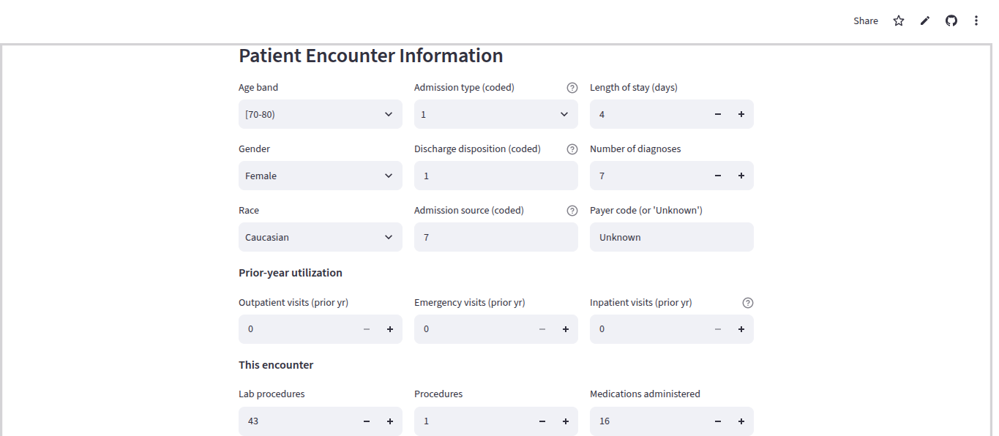

## Screenshots & Demonstrations

| File name | What to capture / Description | Screenshot |
|---|---|---|
| `01_app_home.png` | The top of the web app, with the yellow disclaimer visible | [cite: 10] |
| `02_sample_higher_risk.png` | Sample box → *Higher-risk case* selection and dropdown | [cite: 9] |
| `03_form_inpatient_5.png` | Patient Encounter Information form (Demographics & Prior utilization) | [cite: 8] |
| `03_form_inpatient_5.png` | Patient Encounter Information form (Diabetes & Lab fields) | [cite: 7] |
| `03_form_inpatient_5.png` | Patient Encounter Information form (Diagnosis groups & Predict button) | [cite: 6] |
| `09_github_repo.png` | The GitHub repository page (`tsega-ab1/diabetic-readmission-risk`) | [cite: 5] |
| `08_streamlit_cloud.png` | The deployed app open in the browser with public address bar | [cite: 4] |
| `05_tests_passing.png` | Terminal output after `python -m pytest tests -v` (23 passed) | [cite: 3] |
| `07_mlflow_ui.png` | MLflow UI experiment evaluation table (`FINAL LightGBM`) | [cite: 2] |
| `06_api_docs.png` | FastAPI documentation (`http://localhost:8000/docs`) | [cite: 1] |
