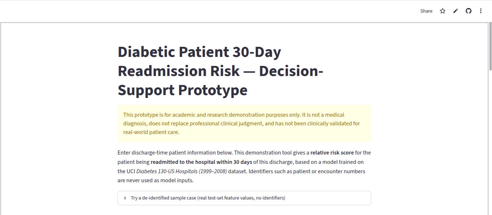
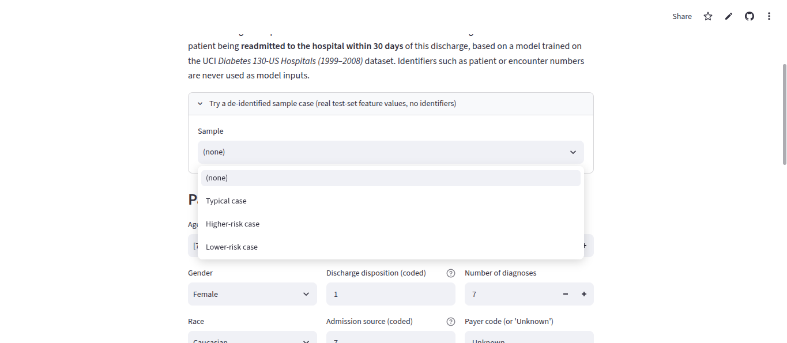
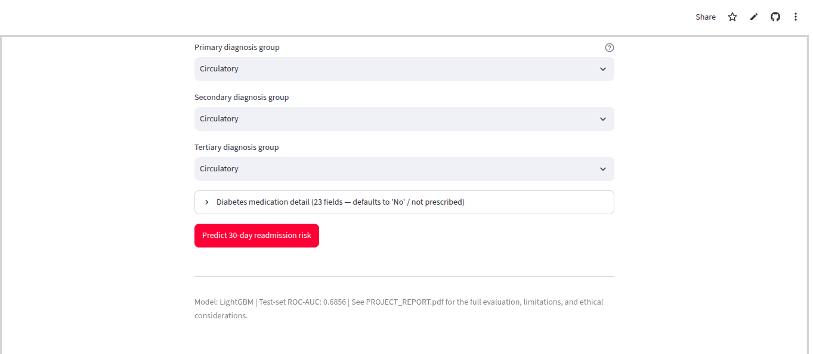
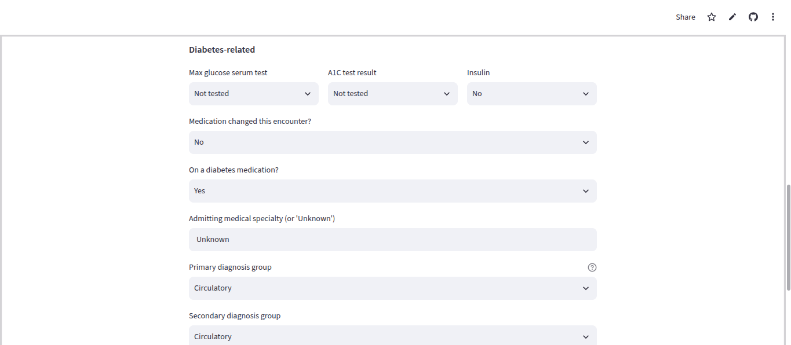
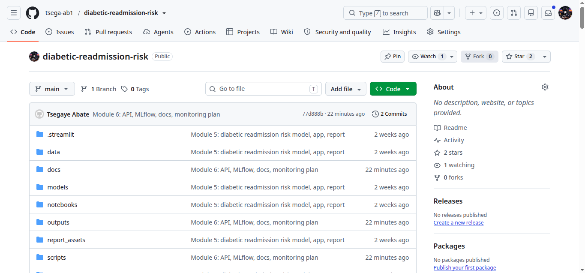
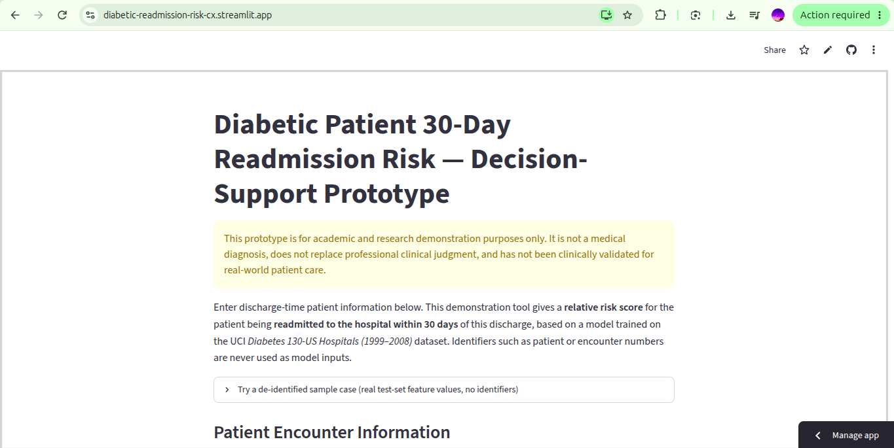
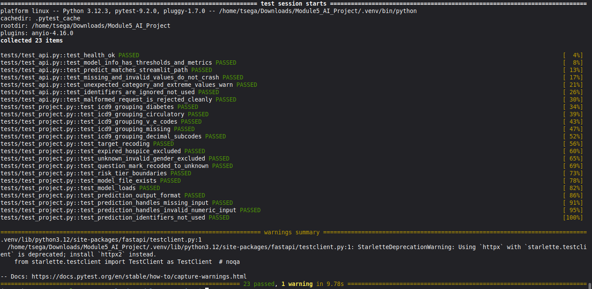
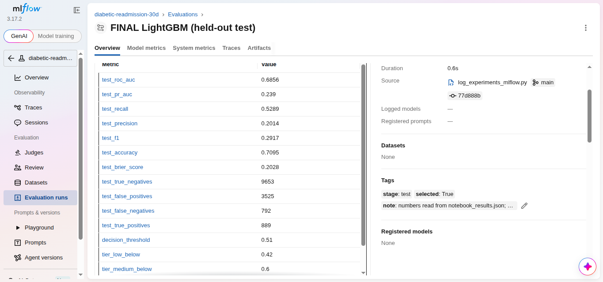
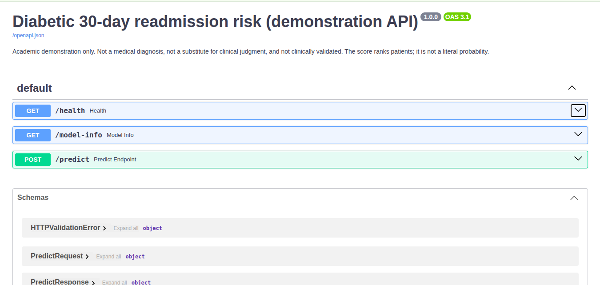

## Screenshots & Demonstrations

| File name | What to capture / Description | Screenshot |
|---|---|---|
| `01_app_home.png` | The top of the web app, with the yellow disclaimer visible | [cite: 10] |
| `02_sample_higher_risk.png` | Sample box → *Higher-risk case* → *Score this sample case* → result (about 69.0%, High) | [cite: 9] |
| `03_form_inpatient_5.png` | Form with *Inpatient visits (prior yr)* = 5 → *Predict* → result (about 78.5%, High) | [cite: 8] |
| `04_warning_xyz.png` | Type `XYZ` in *Discharge disposition* → *Predict* → the blue warning box |  |
| `05_tests_passing.png` | Terminal after `python -m pytest tests -v` (last line: 23 passed; needs `requirements-api.txt`) | [cite: 3] |
| `06_api_docs.png` | `http://localhost:8000/docs` after `python -m uvicorn api:app --port 8000` | [cite: 1] |
| `07_mlflow_ui.png` | `http://localhost:5000` after `mlflow ui --backend-store-uri sqlite:///mlflow.db`, showing the experiment table | [cite: 2] |
| `08_streamlit_cloud.png` | The deployed app open in the browser, with the public address bar visible | [cite: 4] |
| `09_github_repo.png` | The GitHub repository page | [cite: 5] |
| `10_additional_docs.png` | Additional API or component documentation view |  |
